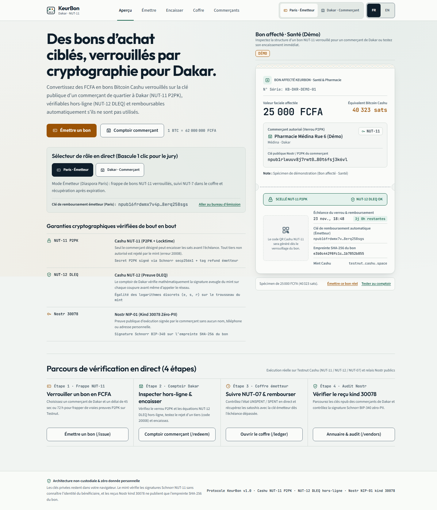
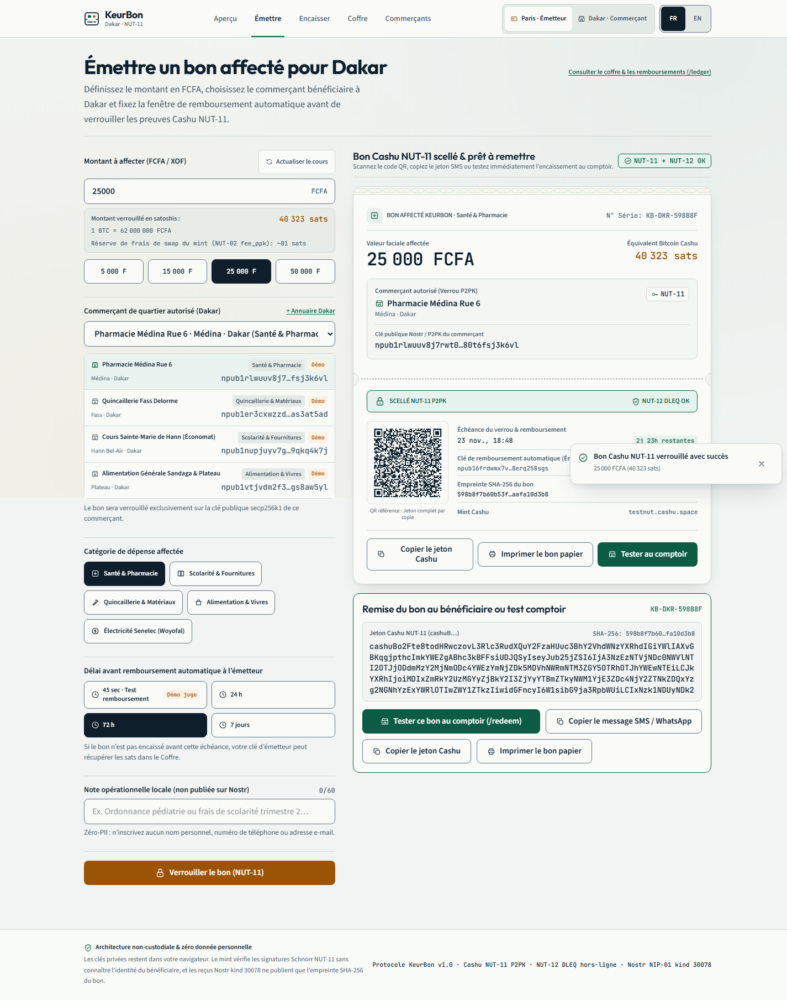
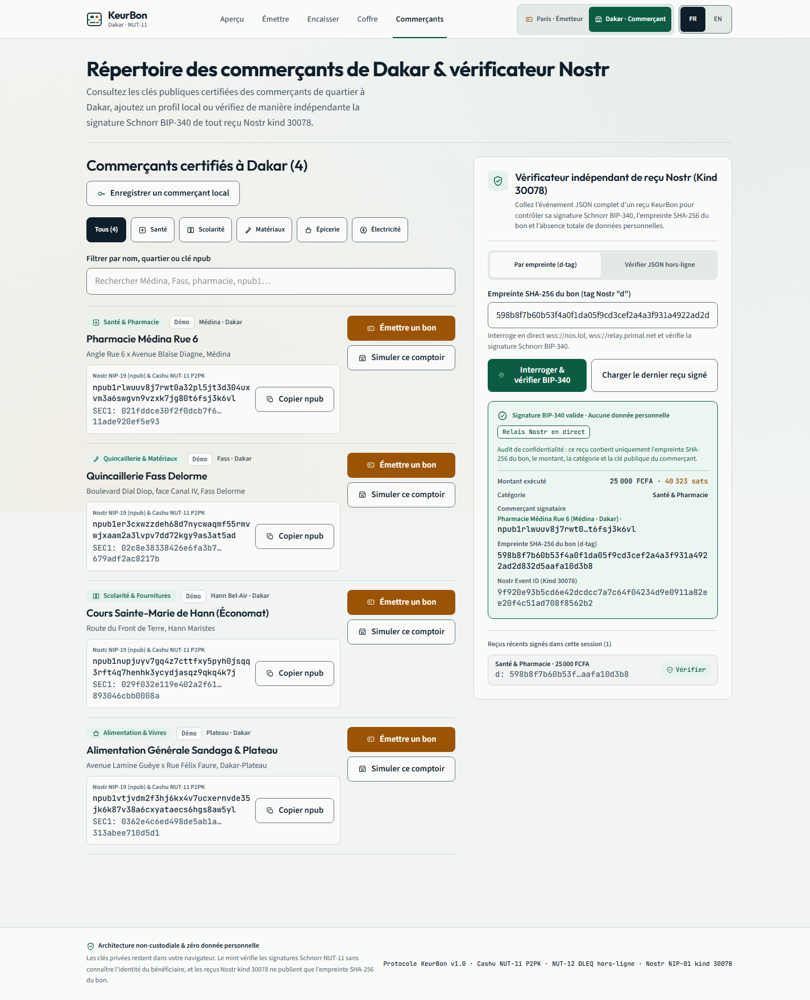
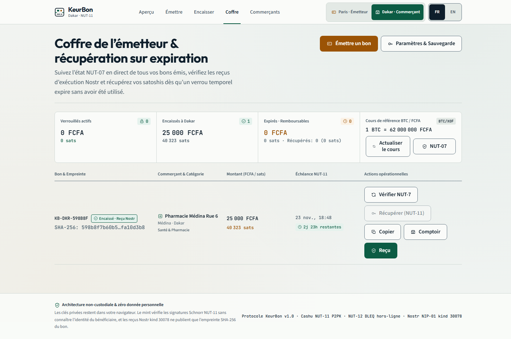

# KeurBon

**Non-custodial, purpose-locked diaspora vouchers for Dakar built on Cashu NUT-11 P2PK, offline NUT-12 DLEQ verification, and zero-PII Nostr fulfillment receipts.**

KeurBon combines the Wolof word *keur* (household) and the French word *bon* (voucher). Senegalese workers in Paris, New York, and Madrid send regular financial support to relatives in Dakar for essential household needs: prescription medicine at a neighborhood pharmacy, school tuition at the bursar's office, bags of cement at a hardware depot, or staples at a corner grocery.

Standard money transfers and mobile money payouts deliver fungible cash. A diaspora sender pays high remittance fees and receives zero cryptographic proof that the transfer paid for medicine or tuition. Centralized voucher intermediaries introduce the opposite problem: they hold customer funds in custodial databases, charge merchant middleman fees, and collect sensitive personal identity documents from both sender and recipient.

KeurBon eliminates the custodial middleman by encoding voucher spending rules directly inside Bitcoin Cashu blind-signed ecash tokens (`@cashu/cashu-ts@4.13.1`) and publishing verifiable merchant fulfillment proofs over Nostr (`nostr-tools@2.26.1`):

1. **Vendor-Locked Issuance (Cashu NUT-11 P2PK):** The sender locks satoshis to a specific Dakar merchant's compressed `secp256k1` public key (`02...` / `03...`) with an explicit UNIX `locktime` and the sender's own `refund` public key.
2. **Offline Counter Verification (Cashu NUT-12 DLEQ):** Before making a network request on 3G or 2G, the Dakar vendor's browser inspects the token offline, verifying the NUT-11 P2PK lock target and checking the mint's Discrete Logarithm Equality (DLEQ) blind signature against the cached keyset.
3. **Schnorr Claim and Unauthorized Rejection:** Only the holder of the locked vendor private key can produce the BIP-340 Schnorr witness required by the mint's `/v1/swap` endpoint. Any third-party key attempt is rejected by the mint with `HTTP 400 (code 20008: P2PK spend conditions are not met)`.
4. **Zero-PII Fulfillment Receipt (Nostr Kind 30078):** Upon redemption, the vendor signs and broadcasts a parameterized replaceable Nostr receipt (`kind 30078`) keyed by the SHA-256 hash of the voucher token (`d`-tag) to `wss://nos.lol` and `wss://relay.primal.net`. The receipt proves category, amount, timestamp, and merchant signature without exposing a single family name, phone number, or street address.
5. **Post-Expiry Sender Refund (NUT-7 + NUT-11 Refund Key):** If the family does not use the voucher before `locktime`, the sender checks live NUT-7 spend state (`UNSPENT`) and reclaims the satoshis in one click using the local refund private key.

---

## System Architecture


### Cryptographic Protocol Stack

| Protocol Layer | Standard / Spec | Implementation in KeurBon | Verification Mode |
| :--- | :--- | :--- | :--- |
| **Mint Issuance** | Cashu NUT-4 | `wallet.createMintQuoteBolt11` and `wallet.mintProofsBolt11` against `https://testnut.cashu.space` (`cdk-mintd/0.18.1`) | Live HTTPS mint quote & blind signature |
| **Purpose & Expiry Lock** | Cashu NUT-10 / NUT-11 | `LockBuilder().addMainPubkey(vendorPk).lockUntil(unixSec).addRefundPubkey(senderPk)` via `wallet.ops.send().asLocked(lock)` | Enforced by mint on `/v1/swap` via BIP-340 Schnorr witness |
| **Offline Mint Proof Check** | Cashu NUT-12 | `verifyMintSignatures(proofs, getKeyset, { require: true })` validates `(e, s)` DLEQ proofs against cached mint pubkeys | 100% offline in browser before network swap |
| **Spend State Audit** | Cashu NUT-7 | `wallet.checkProofsStates(proofs)` returns per-proof state (`UNSPENT`, `SPENT`, `PENDING`) | Live HTTPS query from `/ledger` vault |
| **Fulfillment Receipt** | Nostr NIP-01 / NIP-33 (`kind 30078`) | `finalizeEvent` signs a zero-PII receipt with `['d', sha256(token)]` published to `wss://nos.lol` and `wss://relay.primal.net` | Public relay fetch or offline BIP-340 `verifyEvent` |

---

## 5-Route Product Map

KeurBon runs as a 5-route `BrowserRouter` application designed in a Dakar Architectural Daylight and Security-Paper Financial aesthetic (`DESIGN.md`), with French-first (`FR`) copy and an instant English (`EN`) toggle in the top header.

| Route | Title (`FR` / `EN`) | Primary Actor | Core Operational Jobs |
| :--- | :--- | :--- | :--- |
| `/` | **Aperçu** / **Overview** | Diaspora Sender, Dakar Vendor, Judges | Understand the cryptographic flow, switch active demo persona (`Paris` Sender vs `Dakar` Vendor), inspect the interactive Purpose Voucher Stub, and jump directly to issuance or counter redemption. |
| `/issue` | **Émettre** / **Issue** | Diaspora Sender (Paris / NY / Madrid) | Convert FCFA (`XOF`) to satoshis, pick a verified Dakar neighborhood vendor and purpose category, select an expiry locktime (`24h`, `72h`, `7j`, or `45s` judge test), mint a real NUT-11 P2PK voucher, and export via QR, SMS text, or printable voucher sheet. |
| `/redeem` | **Encaisser** / **Redeem** | Dakar Neighborhood Vendor | Paste or load a `cashuB...` voucher token, run 100% offline NUT-11 P2PK lock inspection and NUT-12 DLEQ signature verification, test live mint rejection with an unauthorized third-party key, claim sats with the vendor Schnorr key, and broadcast a zero-PII Nostr `kind 30078` receipt. |
| `/ledger` | **Coffre** / **Vault** | Diaspora Sender | Audit all issued vouchers in a hairline-ruled ledger, query live NUT-7 proof spend states (`UNSPENT` / `SPENT`), watch real-time locktime countdowns, reclaim expired unspent vouchers in one click, and export or import a local JSON vault backup. |
| `/vendors` | **Commerçants** / **Vendors** | Senders, Vendors, Independent Auditors | Filter Dakar neighborhood merchants by category (`Santé`, `Scolarité`, `Matériaux`, `Épicerie`, `Électricité`), register a new local vendor with an in-browser `secp256k1` / Nostr keypair, and verify any Nostr `kind 30078` fulfillment receipt by voucher SHA-256 hash or raw signed JSON. |

---

## Live Screenshots

Every screenshot below comes from the compiled production bundle running against live `https://testnut.cashu.space` and live Nostr relays (`wss://nos.lol`, `wss://relay.primal.net`).

### 1. Overview (`/`) on Desktop and Mobile
The overview desk explains the NUT-11 P2PK, NUT-12 DLEQ, and Nostr `kind 30078` guarantees alongside the Paris/Dakar role switcher and a tactile Purpose Voucher Stub.



<p align="center">
  
</p>

### 2. Purpose-Locked Voucher Issuance (`/issue`)
Issuing a 25,000 FCFA (`40,323 sats`) pharmacy voucher on `testnut.cashu.space` stamps the Baobab Emerald `SCELLÉ NUT-11 P2PK` seal, renders a scannable QR code, and exposes one-click counter handoff to `/redeem`.



### 3. Dakar Vendor Counter Redemption & Nostr Receipt (`/redeem`)
The merchant counter inspects the token offline (`9/9` NUT-12 DLEQ proofs verified), lets judges test unauthorized key rejection (`code 20008`), claims the sats with the pharmacy's Schnorr key, and publishes a zero-PII `kind 30078` receipt to `2/2` Nostr relays.


### 4. Dakar Vendor Registry & Independent Receipt Verifier (`/vendors`)
Senders and auditors browse Dakar merchant `npub` identities, register local vendor keypairs in-browser, and verify BIP-340 Schnorr receipt signatures directly from live Nostr relays or offline JSON.



### 5. Sender Vault & Post-Expiry Refund Recovery (`/ledger`)
The sender vault tracks issued vouchers with tabular FCFA/sats totals, live NUT-7 spend-state queries, locktime countdowns, one-click post-expiry NUT-11 refund recovery, and local JSON backup export/import.



---

## 2-Minute Live Judge Demo Walkthrough

Follow these six steps in the running app to test every cryptographic guarantee against live Cashu (`https://testnut.cashu.space`) and Nostr (`wss://nos.lol`, `wss://relay.primal.net`) endpoints with zero mocks:

### 1. Test Instant Bilingual Parity (`FR | EN`) and Role Switching
1. Open `/` (`Aperçu` / `Overview`).
2. Click the **`FR | EN`** segmented toggle in the top navigation bar. All navigation links, form labels, status seals, and protocol specifications switch immediately between French and English.
3. Use the **`Paris` / `Dakar`** Role Switcher in the header (or on the overview desk) to inspect the active deterministic demo keypairs for the Paris diaspora sender and Dakar neighborhood vendors.

### 2. Lock a Real NUT-11 P2PK Purpose Voucher on `testnut.cashu.space`
1. Navigate to **`/issue`** (`Émettre` / `Issue`).
2. Select a preset denomination such as **`15 000 FCFA`** (or enter a custom FCFA amount) and pick **`Pharmacie Médina Rue 6`** (`Santé` / `Health`, Médina, Dakar).
3. Under the refund locktime selector, choose **`72h`** for a standard voucher or **`45s (Test juge)`** to test live locktime expiry within the demo session.
4. Click **`Verrouiller le bon`** (`Lock voucher`). KeurBon requests a live NUT-4 BOLT11 quote on `https://testnut.cashu.space`, mints blind-signed proofs, executes a NUT-11 P2PK swap locking the proofs to `Pharmacie Médina Rue 6` with your sender refund pubkey, verifies the NUT-12 DLEQ proofs offline, and stamps the tactile Purpose Voucher Stub with the Baobab Emerald seal.

### 3. Run Offline NUT-11 Lock and NUT-12 DLEQ Inspection
1. Click **`Tester au comptoir (/redeem)`** (`Test at counter`) on the locked voucher stub, or navigate to **`/redeem`** (`Encaisser` / `Redeem`) and click **`Charger le dernier bon émis`** (`Load last issued voucher`).
2. Before contacting the mint to swap funds, inspect the three-row **Cryptographic Inspection Rail**:
   - **Row 1 (Verrou NUT-11 P2PK):** Displays the parsed compressed vendor public key (`02...` / `03...`), the sender refund public key, and the remaining locktime window.
   - **Row 2 (Preuve NUT-12 DLEQ):** Confirms `verifyMintSignatures(..., { require: true })` passed 100% offline against the cached mint keyset for every proof in the token.

### 4. Prove Unauthorized Attacker Key Rejection (`HTTP 400 code 20008`)
1. Stay on **`/redeem`** with the locked voucher loaded.
2. Switch the active counter selector to a different merchant (for example, **`Quincaillerie Fass Delorme`**) or click the **`Tester le rejet par le mint`** (`Test live mint rejection`) button.
3. KeurBon signs the swap request using an unauthorized third-party private key and submits it to `https://testnut.cashu.space/v1/swap`.
4. Observe the live Crimson rejection banner displaying the exact CDK mint error: **`HTTP 400 · code 20008: P2PK spend conditions are not met`**. The voucher remains unspent and protected.

### 5. Claim with Authorized Vendor Schnorr Key and Verify Live Nostr Receipt
1. Switch the active counter vendor back to the designated recipient (**`Pharmacie Médina Rue 6`**) and click **`Encaisser et publier le reçu`** (`Claim & publish receipt`).
2. KeurBon signs the proofs with the pharmacy's `secp256k1` private key, swaps them at the mint for fresh unlocked satoshis, and publishes a signed Nostr `kind 30078` fulfillment receipt to `wss://nos.lol` and `wss://relay.primal.net`.
3. Click **`Vérifier ce reçu sur /vendors`** (`Verify this receipt on /vendors`). The Independent Nostr Receipt Verifier on **`/vendors`** queries the live relays by the voucher's SHA-256 `d`-tag (or verifies the raw JSON offline) and confirms **`Signature BIP-340 valide · Aucune donnée personnelle`** (`Valid BIP-340 signature · Zero PII`).

### 6. Reclaim an Expired Voucher After 45 Seconds on `/ledger`
1. Return to **`/issue`**, select **`45s (Test juge)`** as the refund locktime, and mint a second voucher.
2. Navigate to **`/ledger`** (`Coffre` / `Vault`). Watch the live tabular countdown tick down from `45s` to `0s`, transitioning the row badge to **`Expiré · Remboursable`** (`Expired · Refundable`).
3. Click **`Vérifier NUT-7`** (`Check NUT-7`) to confirm the proofs are still `UNSPENT` on the mint.
4. Click **`Récupérer les sats`** (`Reclaim sats`). KeurBon signs the post-expiry swap with the Paris sender's refund private key, reclaims the satoshis from `https://testnut.cashu.space`, and updates the voucher status to **`Remboursé`** (`Refunded`).

---

## One-Command Setup

### Prerequisites
- **Node.js** `>= 22.x` (tested on Node `v22` and `v24`) and **npm** `>= 10.x`, or **Docker** with **Docker Compose**.

### Option A: Local Development and Test Suite

```bash
# 1. Install dependencies
npm install

# 2. Run the automated Vitest cryptographic & component test suite
npm test

# 3. Start the local Vite development server (http://localhost:5173)
npm run dev

# 4. Build the production TypeScript + Vite bundle into dist/
npm run build
```

### Option B: One-Command Docker Deployment

KeurBon includes a multi-stage `Dockerfile` (`node:22-alpine` build stage to `nginx:1.27-alpine` runtime stage), `nginx.conf` with SPA route fallback (`try_files $uri $uri/ /index.html;`) and security headers, and `docker-compose.yml`:

```bash
docker compose up --build
```

Open **`http://localhost:8080`** in your browser. Direct navigation and page refreshes on `/issue`, `/redeem`, `/ledger`, and `/vendors` resolve cleanly through Nginx.

---

## Security by Design and Threat Model

### 1. Minimal Attack Surface (Zero Custodial Backend)
KeurBon ships as a static client-side single-page application with zero proprietary backend server, zero application database, and zero server-side session state. The browser communicates directly with the configured Cashu mint over HTTPS (`https://testnut.cashu.space`) and public Nostr relays over WSS (`wss://nos.lol`, `wss://relay.primal.net`). Compromising the static web host cannot leak historical user databases because no server database exists.

### 2. Client-Side Key Custody Boundaries
- **Unified `secp256k1` Key Derivation:** Both Cashu NUT-11 P2PK (compressed 33-byte SEC1 public key `02...` / `03...`) and Nostr NIP-01 / NIP-19 (32-byte x-only public key and `npub1...`) derive deterministically from a single 32-byte private key inside the user's browser.
- **Strict Local Storage Isolation:** Private keys reside solely in client browser storage (`localStorage` key `keurbon_v1`) and user-exported JSON backup files. Private keys never appear in URL query strings, Nostr tags, mint memo fields, or console telemetry.
- **Explicit Demo Key Labeling:** Built-in Dakar vendor profiles and the Paris sender profile carry an explicit `Démo` / `Demo` badge so judges can test both counter redemption and post-expiry refunds from a single browser. Users can generate fresh local vendor keypairs or paste a read-only external `npub1...` on `/vendors` at any time.

### 3. Input Validation and Clock-Drift Defense
- **Token and Keyset Hygiene:** `inspectVoucherToken` validates the `cashuB` v4 token prefix, CBOR structure, mint URL, and 66-character v2 keyset IDs before attempting proof inspection. Malformed or truncated SMS tokens trigger specific human-readable recovery instructions.
- **Mint Clock Synchronization:** NUT-11 `locktime` enforcement depends on the Cashu mint's clock rather than the client browser's local clock. KeurBon compares local UNIX time against the mint's reported timestamp during issuance and refund checks so slight device clock drift does not cause premature refund attempts.
- **HTTP Security Headers:** The production `nginx.conf` enforces `X-Content-Type-Options: nosniff`, `X-Frame-Options: DENY`, and `Referrer-Policy: no-referrer`.

### 4. NUT-11 P2PK and NUT-12 DLEQ Cryptographic Guarantees
- **Before `locktime`:** Every proof secret inside a locked voucher carries `["P2PK", {"data": "<vendorCompressedPubkeyHex>", "tags": [["locktime", "<unixSec>"], ["refund", "<senderCompressedPubkeyHex>"]]}]`. The Cashu mint rejects any `/v1/swap` request lacking a valid BIP-340 Schnorr signature from `<vendorCompressedPubkeyHex>`.
- **After `locktime`:** Once the mint's UNIX timestamp exceeds `locktime`, the mint accepts a BIP-340 Schnorr signature from `<senderCompressedPubkeyHex>`, allowing non-custodial recovery of unspent vouchers.
- **Offline Forgery Detection (NUT-12):** Each proof includes a DLEQ tuple `(e, s)`. Calling `verifyMintSignatures(proofs, getKeyset, { require: true })` lets a Dakar vendor verify offline that the mint genuinely blind-signed the token amount before handing over goods or waiting for a slow 2G/3G round-trip.

### 5. Zero PII on Public Nostr Relays
Public Nostr relays store events permanently. KeurBon never writes personal names, phone numbers, email addresses, national ID numbers, or home addresses into Nostr events. Every `kind 30078` fulfillment receipt adheres strictly to the following schema:

```json
{
  "kind": 30078,
  "created_at": 1795174610,
  "pubkey": "ef541bb4207a4af67783e2f33d231ee76ab5baa4c885768a63abcaa16460e377",
  "tags": [
    ["d", "5fc552a4c15202970c90c2868c664848d7ac959ff1a36828cf7cbe59354b2f6a"],
    ["t", "keurbon-receipt"],
    ["v", "npub1aa2phdpq0f90vauruten6gc7ua4ttw4yezzhdznr4092zerqudmszzs0xq"],
    ["amt_sats", "40322"],
    ["amt_xof", "25000"],
    ["cat", "health"],
    ["mint", "https://testnut.cashu.space"],
    ["pii", "none"]
  ],
  "content": "{\"schema\":\"keurbon.receipt.v1\",\"version\":1,\"voucher_hash\":\"5fc552a4c15202970c90c2868c664848d7ac959ff1a36828cf7cbe59354b2f6a\",\"vendor_npub\":\"npub1aa2phdpq0f90vauruten6gc7ua4ttw4yezzhdznr4092zerqudmszzs0xq\",\"amount_sats\":40322,\"amount_xof\":25000,\"category\":\"health\",\"timestamp\":1795174610,\"mint_url\":\"https://testnut.cashu.space\",\"pii\":\"none\"}",
  "sig": "..."
}
```

An outside observer scanning `wss://nos.lol` sees only that a verified merchant `npub` fulfilled a voucher matching SHA-256 hash `5fc552a4...` for a given satoshi and FCFA value. The sender and vendor can prove fulfillment because both hold the pre-image `cashuB...` token that hashes to `d`.

### 6. Explicit Testnut vs Mainnet Mint Disclosure
- **Default Hackathon Mint (`https://testnut.cashu.space`):** Configured out of the box so judges can mint, lock, claim, and refund vouchers immediately without paying real Lightning invoices. `testnut.cashu.space` runs `cdk-mintd/0.18.1` (`FakeWallet`), automatically marks NUT-4 BOLT11 quotes as `PAID` with test satoshis, and charges an active keyset fee of `input_fee_ppk = 100` (`1 sat` minimum swap fee per 10 proofs). KeurBon automatically accounts for this fee reserve during issuance and displays net vs face satoshis transparently.
- **Mainnet Cashu Mint Readiness:** Switching the mint URL to a production Lightning-backed Cashu mint supporting NUT-4, NUT-7, NUT-11, and NUT-12 requires the sender to pay the generated NUT-4 BOLT11 invoice from any Lightning wallet before `mintProofsBolt11` completes. All downstream NUT-11 P2PK locking, offline NUT-12 DLEQ verification, NUT-7 spend checks, and Nostr `kind 30078` receipts execute identically on mainnet and Testnut.

---

## Constraints, Pilot Impact Metrics to Track, and Next-Iteration Roadmap

### Current Operational Constraints
1. **Mint Solvency Window:** While KeurBon removes any KeurBon-operated custodian, Cashu ecash proofs remain bearer claims against the issuing mint between the moment of issuance and the moment the Dakar vendor melts the claimed satoshis over Lightning.
2. **Token Payload Size Over Legacy SMS:** A 3-proof NUT-11 P2PK `cashuB` v4 token with embedded NUT-12 DLEQ proofs measures roughly 1,600 to 1,850 characters. Delivery works cleanly over QR codes, WhatsApp, Telegram, or concatenated multi-part SMS, whereas single-segment 160-character GSM SMS requires a short-link relay or animated QR framing.
3. **Post-Locktime Race Window:** Once `locktime` expires, both the vendor key and the sender refund key can claim the token until one party executes `/v1/swap`. Senders should click **Récupérer les sats / Reclaim sats** promptly upon expiry if a voucher goes unused.

### Pilot Impact Metrics to Track (Dakar Neighborhood Field Trial)
KeurBon does not report fabricated usage statistics. For a planned 30-merchant pilot across Médina, Fass, Hann Bel-Air, and Plateau in Dakar, we track four verifiable operational metrics:

| Pilot Metric | Measurement Method | Target Benchmark to Validate |
| :--- | :--- | :--- |
| **Counter Verification Latency on 3G/2G** | Timestamp delta from QR scan / token paste on `/redeem` to offline NUT-12 DLEQ result and online `/v1/swap` completion on mid-range Android devices | `< 150 ms` offline DLEQ check; `< 3.5 s` end-to-end swap and Nostr receipt broadcast on 3G |
| **Voucher Fulfillment Rate Within Locktime** | Ratio of issued NUT-11 P2PK vouchers redeemed by the designated Dakar vendor before `locktime` expiry (verified via Nostr `kind 30078` receipts) | Track across `24h`, `72h`, and `7j` locktime windows by purpose category (`Santé`, `Scolarité`, `Matériaux`, `Épicerie`) |
| **Expired Voucher Refund Recovery Rate** | Percentage of expired unspent vouchers (`NUT-7 == UNSPENT`) reclaimed by diaspora senders via the `/ledger` refund flow | `100%` of expired unspent vouchers recoverable without customer support tickets |
| **Nostr Receipt Relay Propagation** | Acceptance and query round-trip across `wss://nos.lol`, `wss://relay.primal.net`, and a Dakar community Nostr relay | `>= 2` independent relays confirming each `kind 30078` receipt within `2 s` |

### Next-Iteration Roadmap
1. **Automated Vendor Lightning & Mobile-Money Off-Ramp (NUT-5 Melt):** Allow Dakar vendors on `/redeem` to automatically melt claimed unlocked proofs via Cashu NUT-5 directly to a Lightning Address (`lud16`) or a local Dakar Wave / Orange Money Lightning bridge upon counter settlement.
2. **NIP-07 and Amber Android Signer Integration:** Support hardware-backed or external Nostr signers (NIP-07 browser extensions and Amber on Android) so Dakar merchants can sign NUT-11 P2PK swaps and `kind 30078` receipts without storing raw private keys in `localStorage`.
3. **Animated UR / Multi-Frame QR Scanner for Low-Light Cameras:** Add BC-UR animated QR encoding and an in-browser camera scanner on `/redeem` so 1,800-character NUT-11 tokens scan reliably on older entry-level Android cameras without copy-pasting.
4. **Multi-Mint Federation & Automated Mint Health Probes:** Let diaspora senders distribute voucher liquidity across multiple West African and European Cashu mints with live NUT-7/11/12 capability checks.

---

## License

Released under the [MIT License](LICENSE).
