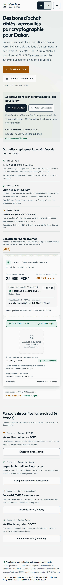
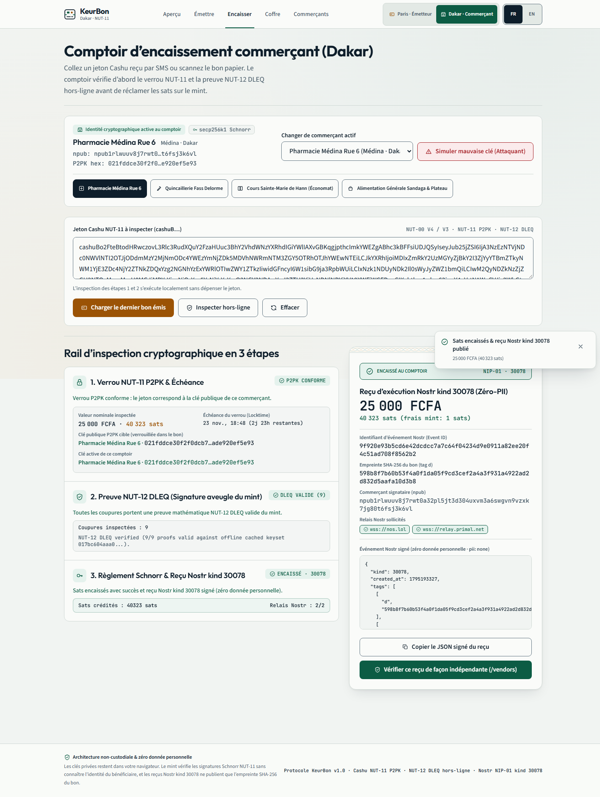

# KeurBon

**Non-custodial, purpose-locked diaspora vouchers for Dakar built on Bitcoin Cashu (`NUT-4`, `NUT-7`, `NUT-11`, `NUT-12`) and zero-PII Nostr receipts (`kind 30078`).**

[](LICENSE)
[](https://keurbon.vercel.app/)
[-C4302B.svg)](https://youtu.be/aTPkaIHO5HU)
[](#cryptographic-protocol-stack)
[](#tech-stack-and-pinned-dependencies)
[](#5-route-product-map)

Built for **Dakar Bitcoin Hack by BTrust 2026**.

- **Live App:** [https://keurbon.vercel.app/](https://keurbon.vercel.app/)
- **3-Minute Demo Video:** [https://youtu.be/aTPkaIHO5HU](https://youtu.be/aTPkaIHO5HU)

---

## Table of Contents

1. [Problem and Local Dakar Context](#problem-and-local-dakar-context)
2. [How KeurBon Works](#how-keurbon-works)
3. [System Architecture](#system-architecture)
4. [Live Screenshots](#live-screenshots)
5. [5-Route Product Map](#5-route-product-map)
6. [2-Minute Live Judge Demo Walkthrough](#2-minute-live-judge-demo-walkthrough)
7. [One-Command Setup](#one-command-setup)
8. [Automated Tests and Verification](#automated-tests-and-verification)
9. [Project Structure](#project-structure)
10. [Tech Stack and Pinned Dependencies](#tech-stack-and-pinned-dependencies)
11. [Design System and Low-Bandwidth Craft](#design-system-and-low-bandwidth-craft)
12. [Security by Design and Threat Model](#security-by-design-and-threat-model)
13. [Constraints, Pilot Impact Metrics, and Roadmap](#constraints-pilot-impact-metrics-and-roadmap)
14. [Contributing and License](#contributing-and-license)

---

## Problem and Local Dakar Context

KeurBon combines the Wolof word *keur* (household) and the French word *bon* (voucher, as in *bon de pharmacie* or *bon de ciment*). Senegalese workers in Paris, Madrid, Italy, and New York send recurring household support to relatives in Dakar for concrete necessities: pediatric prescriptions at a neighborhood pharmacy, term tuition at a school bursar's office, bags of cement at a hardware depot, prepaid Woyofal electricity credit, or staples at a local grocery.

Existing remittance paths leave a structural gap:

- **Fungible cash transfers (Western Union, Ria, Wave, Orange Money):** Senders pay high cross-border and FX margins, funds arrive fungibly in a personal cash wallet where competing emergencies frequently divert them, and confirming how the money was spent falls back to asking family members for blurry WhatsApp receipt photos.
- **Centralized gift-card or voucher intermediaries:** Commercial voucher platforms only cover large supermarket chains rather than neighborhood Dakar pharmacies or hardware shops, hold funds inside custodial databases, charge merchant middleman cuts, and collect personal identity documents from both sender and recipient.

KeurBon removes the custodial intermediary. Spending rules live directly inside blind-signed Bitcoin Cashu ecash proofs (`@cashu/cashu-ts@4.13.1`), and merchant settlement proofs publish as zero-PII Nostr events (`nostr-tools@2.26.1`).

---

## How KeurBon Works

1. **Vendor-Locked Issuance (Cashu NUT-11 P2PK):** The diaspora sender enters an amount in FCFA (`XOF`), selects a Dakar neighborhood merchant, chooses a purpose category and expiry window, and locks satoshis to that merchant's compressed `secp256k1` public key (`02...` / `03...`) with an embedded UNIX `locktime` and the sender's own `refund` public key.
2. **Low-Bandwidth Bearer Delivery:** The app renders a tactile, printable Purpose Voucher Stub with a QR code and copyable SMS/WhatsApp text. The relative in Dakar carries the voucher to the shop without needing a bank account, KYC profile, or app login.
3. **Offline Counter Verification (Cashu NUT-12 DLEQ):** On 3G, 2G, or intermittent mobile connectivity, the Dakar merchant pastes or loads the voucher on `/redeem`. Before touching the network, the browser decodes the token, checks that the NUT-11 P2PK lock matches the merchant's public key, and runs Discrete Logarithm Equality (`DLEQ`) verification against the cached mint keyset.
4. **Schnorr Claim and Unauthorized Rejection:** Only the designated merchant's private key can sign the BIP-340 Schnorr witness required by the mint's `/v1/swap` endpoint. Any third-party key attempt fails with `HTTP 400 (code 20008: P2PK spend conditions are not met)`.
5. **Zero-PII Fulfillment Receipt (Nostr Kind 30078):** Once the mint settles the swap, the merchant signs and broadcasts a parameterized replaceable Nostr receipt (`kind 30078`) keyed by the SHA-256 hash of the voucher token (`d`-tag) to `wss://nos.lol` and `wss://relay.primal.net`. The receipt proves vendor `npub`, satoshi and FCFA amounts, category, and timestamp without publishing a single family name, phone number, or home address.
6. **Automatic Post-Expiry Sender Refund (NUT-7 + NUT-11 Refund Key):** If a voucher goes unused past its `locktime`, the sender checks live NUT-7 spend state (`UNSPENT`) on `/ledger` and reclaims the satoshis in one click with the local refund private key.

---

## System Architecture



### Cryptographic Protocol Stack

| Protocol Layer | Standard / Spec | Implementation in KeurBon | Verification Mode |
| :--- | :--- | :--- | :--- |
| **Mint Issuance** | Cashu NUT-4 | `wallet.createMintQuoteBolt11` and `wallet.mintProofsBolt11` against `https://testnut.cashu.space` (`cdk-mintd/0.18.1`) | Live HTTPS mint quote and blind signature |
| **Purpose & Expiry Lock** | Cashu NUT-10 / NUT-11 | `LockBuilder().addMainPubkey(vendorPk).lockUntil(unixSec).addRefundPubkey(senderPk)` via `wallet.ops.send().asLocked(lock).includeFees(true)` | Enforced by mint on `/v1/swap` via BIP-340 Schnorr witness |
| **Offline Mint Proof Check** | Cashu NUT-12 | `verifyMintSignatures(proofs, getKeyset, { require: true })` validates `(e, s)` DLEQ proofs against cached mint pubkeys | 100% offline in browser before any network swap |
| **Spend State Audit** | Cashu NUT-7 | `wallet.checkProofsStates(proofs)` returns per-proof state (`UNSPENT`, `SPENT`, `PENDING`) | Live HTTPS query from `/ledger` vault |
| **Fulfillment Receipt** | Nostr NIP-01 / NIP-33 (`kind 30078`) | `finalizeEvent` signs a zero-PII receipt with `['d', sha256(token)]` published to `wss://nos.lol` and `wss://relay.primal.net` | Public relay fetch or offline BIP-340 `verifyEvent` |
| **Reference FX Rate** | CoinGecko Simple Price API | Fetches live `BTC/XOF` with EUR fixed-peg fallback (`1 EUR = 655.957 XOF`), cached local fallback, and manual rate override | HTTPS fetch with offline cache fallback |

---

## Live Screenshots

Every screenshot below was captured from the compiled production bundle running against live `https://testnut.cashu.space` and live Nostr relays (`wss://nos.lol`, `wss://relay.primal.net`).

### 1. Overview (`/`) on Desktop and Mobile
Asymmetric split-desk overview introducing the NUT-11 P2PK, NUT-12 DLEQ, and Nostr `kind 30078` guarantees alongside the live Paris/Dakar role switcher and a tactile Purpose Voucher Stub.


<p align="center">
  
</p>

### 2. Purpose-Locked Voucher Issuance (`/issue`)
Issuing a 25,000 FCFA (`40,323 sats`) pharmacy voucher on `testnut.cashu.space` stamps the Baobab Emerald `SCELLÉ NUT-11 P2PK` seal, renders a scannable QR code, and opens one-click counter handoff to `/redeem`.


### 3. Dakar Vendor Counter Redemption and Nostr Receipt (`/redeem`)
The merchant counter inspects the token offline (`9/9` NUT-12 DLEQ proofs valid), supports live unauthorized key rejection testing (`code 20008`), claims sats with the pharmacy's Schnorr key, and broadcasts a zero-PII `kind 30078` receipt to `2/2` Nostr relays.



### 4. Dakar Vendor Registry and Independent Receipt Verifier (`/vendors`)
Senders and independent auditors filter Dakar neighborhood merchants by category, register fresh local vendor `secp256k1` / `npub` keypairs in-browser, and verify BIP-340 Schnorr receipt signatures directly from live Nostr relays or offline JSON.


### 5. Sender Vault and Post-Expiry Refund Recovery (`/ledger`)
The sender vault tracks issued vouchers with tabular FCFA/sats totals, live NUT-7 spend-state checks, real-time expiry countdowns, one-click post-expiry NUT-11 refund recovery, and local JSON backup export/import.


---

## 5-Route Product Map

KeurBon ships as a multi-page `BrowserRouter` application with five distinct deep-linkable URLs, French-first (`FR`) copy, and an instant English (`EN`) toggle in the persistent top navigation bar.

| Route | Title (`FR` / `EN`) | Primary Actor | Core Operational Jobs |
| :--- | :--- | :--- | :--- |
| `/` | **Aperçu** / **Overview** | Diaspora Sender, Dakar Vendor, Judges | Inspect the cryptographic guarantees, toggle the live demo persona (`Paris` Sender vs `Dakar` Vendor), preview the Purpose Voucher Stub, and jump directly into issuance or counter redemption. |
| `/issue` | **Émettre** / **Issue** | Diaspora Sender (Paris / NY / Madrid) | Convert FCFA (`XOF`) to satoshis, pick a Dakar merchant and purpose category (supports `?vendor=<id>` deep links), choose an expiry locktime (`24h`, `72h`, `7j`, or `45s` judge test), mint a real NUT-11 P2PK voucher, and export via QR, SMS/WhatsApp text, or print. |
| `/redeem` | **Encaisser** / **Redeem** | Dakar Neighborhood Vendor | Auto-load or paste a `cashuB...` token, run 100% offline NUT-11 P2PK lock inspection and NUT-12 DLEQ verification, test live mint rejection with an unauthorized third-party key, claim sats with the vendor Schnorr key, and publish a zero-PII Nostr `kind 30078` receipt. |
| `/ledger` | **Coffre** / **Vault** | Diaspora Sender | Track all issued vouchers in a hairline-ruled operational ledger, query live NUT-7 spend states (`UNSPENT` / `SPENT`), watch 1-second locktime countdowns, reclaim expired unspent vouchers in one click, configure mint URL or FX rate, and export/import local JSON vault backups. |
| `/vendors` | **Commerçants** / **Vendors** | Senders, Vendors, Independent Auditors | Filter Dakar merchants by category (`?cat=` URL-synced), register a new local vendor with an in-browser `secp256k1` keypair or paste an external `npub1...`, and independently verify any Nostr `kind 30078` receipt by voucher SHA-256 hash (`?hash=`) or offline signed JSON. |

---

## 2-Minute Live Judge Demo Walkthrough

Run these six steps in the app to verify every cryptographic guarantee against live Cashu (`https://testnut.cashu.space`) and live Nostr relays (`wss://nos.lol`, `wss://relay.primal.net`) with zero mocks:

### Step 1: Switch Language (`FR | EN`) and Persona
1. Open `/` (`Aperçu` / `Overview`).
2. Click **`FR | EN`** in the header to switch all navigation links, forms, status seals, and protocol labels between French and English without losing state.
3. Toggle **`Paris · Émetteur`** and **`Dakar · Commerçant`** to inspect the seeded deterministic demo keypairs.

### Step 2: Lock a Real NUT-11 P2PK Voucher on `testnut.cashu.space`
1. Navigate to **`/issue`**.
2. Pick **`15 000 FCFA`** or **`25 000 FCFA`** and select **`Pharmacie Médina Rue 6`** (`Santé & Pharmacie`).
3. Choose **`72h`** (or **`45 sec · Test remboursement`** to test live expiry within one minute).
4. Click **`Verrouiller le bon (NUT-11)`**. KeurBon creates a live NUT-4 BOLT11 quote on `https://testnut.cashu.space`, mints blind-signed proofs with `fee_ppk` headroom, executes a NUT-11 P2PK swap locked to the pharmacy's public key with your sender refund pubkey, verifies NUT-12 DLEQ proofs offline, and stamps the Purpose Voucher Stub with the Baobab Emerald seal and QR code.

### Step 3: Run 100% Offline NUT-11 Lock and NUT-12 DLEQ Inspection
1. Click **`Tester au comptoir`** on the locked voucher stub. KeurBon switches the active counter to `Pharmacie Médina Rue 6`, navigates to **`/redeem`**, auto-loads the `cashuB...` token, and runs offline inspection immediately.
2. Inspect the 3-row **Cryptographic Inspection Rail**:
   - **Row 1 (`Verrou NUT-11 P2PK`):** Matches the parsed compressed vendor public key (`02...`) and displays the remaining locktime window.
   - **Row 2 (`Preuve NUT-12 DLEQ`):** Confirms every proof passed `verifyMintSignatures(..., { require: true })` offline against the cached mint keyset.

### Step 4: Prove Unauthorized Attacker Rejection (`HTTP 400 code 20008`)
1. On **`/redeem`**, click **`Simuler mauvaise clé (Attaquant)`** (or select a different Dakar merchant).
2. The offline rail immediately flags a P2PK key mismatch. Click **`Tester le rejet par le mint`** to submit a swap signed with the unauthorized private key to `https://testnut.cashu.space/v1/swap`.
3. Confirm the live Crimson alert displaying the mint's cryptographic rejection: **`code 20008: P2PK spend conditions are not met`**.

### Step 5: Claim with Vendor Schnorr Key and Verify Live Nostr Receipt
1. Switch back to **`Pharmacie Médina Rue 6`** and click **`Encaisser et publier le reçu`**.
2. KeurBon signs the P2PK proofs with the pharmacy's `secp256k1` private key, swaps them at the mint, and publishes a signed Nostr `kind 30078` receipt to `wss://nos.lol` and `wss://relay.primal.net`.
3. Click **`Vérifier ce reçu de façon indépendante (/vendors)`**. The verifier on **`/vendors?hash=...`** fetches the receipt from live relays and displays **`Signature BIP-340 valide · Aucune donnée personnelle`**.

### Step 6: Reclaim an Expired Voucher After 45 Seconds on `/ledger`
1. Return to **`/issue`**, choose **`45 sec · Test remboursement`**, and lock a second voucher.
2. Open **`/ledger`** and watch the live tabular countdown reach `0s`, switching the badge to **`Expiré · Remboursable`**.
3. Click **`Vérifier NUT-7`** to confirm the proofs remain `UNSPENT` on the mint, then click **`Récupérer (NUT-11)`** to reclaim the satoshis using the Paris sender's refund key.

---

## One-Command Setup

### Prerequisites
- **Node.js** `>= 22.x` (verified on Node `v24.19.0`) and **npm** `>= 10.x`, or **Docker** with **Docker Compose**.

### Option A: Local Development and Production Build

```bash
# Install pinned dependencies
npm install

# Run the automated Vitest suite (unit + live Testnut integration)
npm test

# Start the local Vite dev server at http://localhost:5173
npm run dev

# Build and preview the production bundle
npm run build
npm run preview
```

### Option B: One-Command Docker Deployment

KeurBon ships with a multi-stage `Dockerfile` (`node:22-alpine` build -> `nginx:1.27-alpine` runtime), `nginx.conf` (with SPA `try_files` fallback for all 5 routes plus security headers and gzip), and `docker-compose.yml`:

```bash
docker compose up --build
```

Open **`http://localhost:8080`**. Direct URL loads and page refreshes on `/issue`, `/redeem`, `/ledger`, and `/vendors` resolve cleanly through Nginx.

---

## Automated Tests and Verification

Run `npm test` (`vitest run`) to execute all 3 suites (16 tests total):

| Test File | Tests | What It Verifies |
| :--- | :---: | :--- |
| `src/lib/fx.test.ts` | 7 | Integer FCFA-to-sats and sats-to-FCFA conversion, zero/NaN guards, EUR fixed-peg (`655.957`) fallback, French/English `Intl.NumberFormat` formatting |
| `src/lib/nostr.test.ts` | 4 | Zero-PII payload enforcement (rejects names/emails/phones), `kind 30078` tag schema construction, BIP-340 Schnorr signing and verification, tampered-content and tampered-signature negative controls |
| `src/lib/cashu.test.ts` | 5 | Compressed vs x-only pubkey matching, P2PK secret tuple parsing, offline NUT-12 DLEQ verification + 1-byte tamper negative control, and a full live `https://testnut.cashu.space` integration test (NUT-4 mint -> NUT-11 P2PK lock -> unauthorized attacker rejection `code 20008` -> authorized vendor Schnorr claim -> NUT-7 `UNSPENT` to `SPENT`) |

**Browser verification performed on the production bundle (`dist/`):**
- Headless Chrome tested all 5 routes across `375px`, `390px`, `768px`, `1024px`, and `1440px` viewports with `0` horizontal overflows, `0` console errors, `0` page errors, WCAG 2.1 AA contrast `>= 4.5:1` across all text pairs, `>= 44x44px` tap targets on mobile buttons/inputs, and `prefers-reduced-motion: reduce` fallback.

---

## Project Structure

```text
keurbon/
├── DESIGN.md                     # Normative 9-section design system specification
├── Dockerfile                    # Multi-stage Node 22 -> Nginx 1.27 build
├── docker-compose.yml            # One-command container startup on port 8080
├── nginx.conf                    # SPA routing for all 5 routes + security headers
├── LICENSE                       # MIT License
├── README.md
├── docs/
│   ├── architecture.svg          # Brand-matched vector architecture diagram
│   └── screenshots/              # Verified live screenshots of all 5 routes
└── src/
    ├── App.tsx                   # 5-route BrowserRouter definition + 404 fallback
    ├── main.tsx                  # Self-hosted @fontsource imports + app entry
    ├── index.css                 # Tailwind v4 theme, daylight wash, Lock-Snap keyframes
    ├── styles/tokens.css         # CSS custom properties matching DESIGN.md
    ├── types/keurbon.ts          # Shared domain and service TypeScript contracts
    ├── i18n/translations.ts      # Complete French (primary) and English dictionary
    ├── data/demoVendors.ts       # Deterministic Dakar demo vendor & sender keypairs
    ├── state/store.tsx           # Versioned localStorage state (`keurbon_v1`) + backup
    ├── components/
    │   ├── Icons.tsx             # Unified 1.75px stroke inline SVG icon family
    │   ├── Layout.tsx            # Persistent header, FR/EN & role toggles, mobile drawer
    │   ├── VoucherStub.tsx       # Tactile perforated voucher card, QR, Lock-Snap seal
    │   └── ToastRegion.tsx       # Accessible aria-live="polite" toast notifications
    ├── lib/
    │   ├── cashu.ts              # NUT-4, NUT-7, NUT-11 P2PK, NUT-12 offline DLEQ
    │   ├── nostr.ts              # Zero-PII kind 30078 signing, relay pub/query, BIP-340
    │   ├── fx.ts                 # Live CoinGecko BTC/XOF + cached/manual fallback
    │   └── *.test.ts             # Vitest unit and live Testnut integration tests
    └── pages/
        ├── OverviewPage.tsx      # /
        ├── IssuePage.tsx         # /issue
        ├── RedeemPage.tsx        # /redeem
        ├── LedgerPage.tsx        # /ledger
        └── VendorsPage.tsx       # /vendors
```

---

## Tech Stack and Pinned Dependencies

| Layer | Package / Tool | Version | Role |
| :--- | :--- | :--- | :--- |
| **UI & Routing** | `react`, `react-dom`, `react-router-dom` | `19.1.0` / `7.5.0` | Multi-route client SPA with deep-linkable state |
| **Build & Styling** | `vite`, `typescript`, `tailwindcss`, `@tailwindcss/vite` | `6.3.1` / `5.8.3` / `4.1.4` | Fast static bundle, strict type checking, token-driven CSS |
| **Cashu Protocol** | `@cashu/cashu-ts` | `4.13.1` | NUT-4 minting, NUT-11 `LockBuilder` P2PK, NUT-12 DLEQ, NUT-7 state |
| **Nostr Protocol** | `nostr-tools` | `2.26.1` | BIP-340 Schnorr signing/verification, `nip19`, `SimplePool` relay I/O |
| **Self-Hosted Fonts** | `@fontsource/outfit`, `@fontsource/source-sans-3`, `@fontsource/jetbrains-mono` | `5.2.5` | Offline-capable woff2 typography (zero runtime CDN links) |
| **QR Generation** | `qrcode` | `1.5.4` | Offline browser QR rendering with multi-proof compact fallback |
| **Testing** | `vitest`, `jsdom`, `@testing-library/react` | `3.1.1` / `26.1.0` / `16.3.0` | Automated cryptographic unit and live Testnut tests |

---

## Design System and Low-Bandwidth Craft

Full visual tokens, typography scales, elevation rules, and component states live in [DESIGN.md](DESIGN.md). Key choices built specifically for Dakar's mobile environment:

- **Dakar Architectural Daylight:** High-contrast Mineral Mist canvas (`#F1F4F2`), Crisp Voucher Stock (`#FAFBF9`), Deep Atlantic Slate Ink (`#0E1E2B`), Baobab Emerald (`#0C5C44`) for verified cryptographic states, and Sahel Saffron (`#9B5305`) as the single action accent, engineered for outdoor legibility on mid-range Android screens.
- **Zero External Font or Icon CDNs:** All fonts bundle as local `@fontsource` woff2 files, and all UI icons ship as lightweight inline SVGs (`1.75px` stroke).
- **Accessible Motion with Reduced-Motion Support:** One subject-grounded signature moment (**Cryptographic Lock-Snap Seal**, `420ms`) when sealing or verifying a voucher, collapsing cleanly to an instant static seal under `prefers-reduced-motion: reduce`.

---

## Security by Design and Threat Model

### 1. Minimal Attack Surface (Zero Custodial Backend)
KeurBon ships as a static client-side application with no backend server, no central database, and no server-held keys. The browser talks directly to the configured Cashu mint over HTTPS (`https://testnut.cashu.space`) and public Nostr relays over WSS (`wss://nos.lol`, `wss://relay.primal.net`).

### 2. Threat Model Matrix

| Threat / Attack Vector | Cryptographic or Architectural Mitigation |
| :--- | :--- |
| **Diverted remittance cash** | Proofs are locked via Cashu NUT-11 P2PK to the chosen Dakar merchant's compressed `secp256k1` pubkey. Relatives or third parties cannot swap the proofs elsewhere; the mint rejects unauthorized keys with `HTTP 400 code 20008`. |
| **Forged voucher at offline counter** | Before handing over medicine or goods on flaky 2G/3G, `/redeem` verifies NUT-12 DLEQ proofs (`verifyMintSignatures(..., { require: true })`) offline against the cached mint keyset. |
| **Lost or unused voucher funds** | Every NUT-11 secret embeds an explicit `locktime` and the sender's `refund` pubkey. Once expired, the sender reclaims unspent proofs on `/ledger` without customer support or custodian approval. |
| **Personal data leaked on public Nostr relays** | `assertZeroPiiObject` blocks forbidden personal keys (`name`, `email`, `phone`, `address`, `national_id`) before signing. Only the SHA-256 voucher hash (`d`-tag), merchant `npub`, amount, category, and timestamp are published. |
| **Web server compromise** | No custodial server or user database exists. Production `nginx.conf` enforces `X-Content-Type-Options: nosniff`, `X-Frame-Options: DENY`, and `Referrer-Policy: no-referrer`. |
| **Device clock drift on refund locktime** | Refund eligibility is enforced by the Cashu mint's clock, and KeurBon surfaces mint clock status cleanly on `/ledger`. |

### 3. Client-Side Key Custody Boundaries
- **Unified `secp256k1` Key Derivation:** Both Cashu NUT-11 P2PK compressed pubkeys (`02...` / `03...`) and Nostr x-only `npub1...` identities derive deterministically from one 32-byte private key in-browser.
- **Local Storage Isolation:** Keys and vault records stay in `localStorage` (`keurbon_v1`) and user-exported JSON backups. Demo profiles are explicitly marked `Démo` / `Demo`; users can register fresh local vendor keys or read-only external `npub1...` keys on `/vendors`.

### 4. Exact Zero-PII Nostr Receipt Schema (`kind 30078`)

```json
{
  "kind": 30078,
  "created_at": 1795174610,
  "pubkey": "ef541bb4207a4af67783e2f33d231ee76ab5baa4c885768a63abcaa16460e377",
  "tags": [
    ["d", "5fc552a4c15202970c90c2868c664848d7ac959ff1a36828cf7cbe59354b2f6a"],
    ["t", "keurbon-receipt"],
    ["v", "npub1aa2phdpq0f90vauruten6gc7ua4ttw4yezzhdznr4092zerqudmszzs0xq"],
    ["amt_sats", "40322"],
    ["amt_xof", "25000"],
    ["cat", "health"],
    ["mint", "https://testnut.cashu.space"],
    ["pii", "none"]
  ],
  "content": "{\"schema\":\"keurbon.receipt.v1\",\"version\":1,\"voucher_hash\":\"5fc552a4c15202970c90c2868c664848d7ac959ff1a36828cf7cbe59354b2f6a\",\"vendor_npub\":\"npub1aa2phdpq0f90vauruten6gc7ua4ttw4yezzhdznr4092zerqudmszzs0xq\",\"amount_sats\":40322,\"amount_xof\":25000,\"category\":\"health\",\"timestamp\":1795174610,\"mint_url\":\"https://testnut.cashu.space\",\"pii\":\"none\"}",
  "sig": "..."
}
```

### 5. Explicit Testnut vs Mainnet Mint Disclosure
- **Default Hackathon Mint (`https://testnut.cashu.space`):** Runs `cdk-mintd/0.18.1` with `FakeWallet` so judges can mint, lock, reject unauthorized keys, claim, and refund immediately without spending real BTC. Testnut charges `input_fee_ppk = 100` (`1 sat` swap fee), which KeurBon accounts for automatically via `.includeFees(true)` and transparent fee reserve display.
- **Mainnet Cashu Readiness:** Pointing `/ledger` settings to any Lightning-backed mainnet Cashu mint supporting NUT-4, NUT-7, NUT-11, and NUT-12 runs the exact same cryptographic flow once the sender pays the generated BOLT11 mint invoice.

---

## Constraints, Pilot Impact Metrics, and Roadmap

### Known Operational Constraints
1. **Mint Solvency Window:** Between issuance and merchant settlement, ecash proofs represent bearer claims against the chosen Cashu mint. Merchants should settle claimed sats to Lightning promptly.
2. **Multi-Proof QR Capacity:** Large multi-proof NUT-11 + DLEQ tokens (e.g., 9 proofs, ~5,200 characters) exceed single-frame QR byte limits. `VoucherStub` encodes the full `cashuB...` token directly into the QR whenever it fits (`<= 2,200` chars) and automatically falls back to a compact verification reference QR paired with one-tap Copy / SMS / WhatsApp handoff for larger tokens.
3. **Post-Locktime Race Window:** After `locktime` expires, both the merchant key and the sender refund key remain valid until one party swaps the proofs on the mint. Senders should trigger **`Récupérer (NUT-11)`** promptly if a voucher goes unused.

### Pilot Impact Metrics to Track (Dakar Field Trial)
KeurBon reports zero fabricated traction numbers. For a planned 30-merchant neighborhood trial across Médina, Fass, Hann Bel-Air, and Plateau in Dakar, we track four observable metrics:

| Pilot Metric | Measurement Method | Target Benchmark |
| :--- | :--- | :--- |
| **Counter Verification Latency on 3G/2G** | Elapsed time from token input on `/redeem` to offline NUT-12 DLEQ result and online `/v1/swap` completion on mid-range Android phones | `< 150 ms` offline DLEQ check; `< 3.5 s` end-to-end swap and Nostr broadcast on 3G |
| **Voucher Fulfillment Rate Within Locktime** | Share of issued NUT-11 vouchers redeemed before expiry (verified via Nostr `kind 30078` receipts) | Track across `24h`, `72h`, and `7j` windows by category (`Santé`, `Scolarité`, `Matériaux`, `Épicerie`, `Électricité`) |
| **Expired Voucher Refund Recovery** | Share of expired `UNSPENT` vouchers reclaimed via `/ledger` without manual intervention | `100%` self-service recovery via local refund key |
| **Nostr Receipt Propagation** | Acceptance and fetch round-trip across `wss://nos.lol`, `wss://relay.primal.net`, and a local Dakar community relay | `>= 2` independent relays confirming each receipt within `2 s` |

### Next-Iteration Roadmap
1. **Automated Merchant Lightning & Local Off-Ramp (NUT-5 Melt):** Let Dakar vendors on `/redeem` melt claimed proofs directly to a Lightning Address (`lud16`) or local Wave / Orange Money Lightning bridge upon counter settlement.
2. **External Signer Support (NIP-07 & Android Amber):** Let merchants sign NUT-11 P2PK swaps and `kind 30078` receipts through external signers rather than browser `localStorage`.
3. **BC-UR Animated QR & Camera Scanner:** Encode multi-proof NUT-11 tokens as animated QR frames for camera-only offline counter transfers on low-end Android devices.
4. **Multi-Mint Selection and Health Probes:** Allow senders to select from vetted West African and European Cashu mints with live NUT-7/11/12 capability verification.

---

## Contributing and License

Issues, security reviews, and pull requests are welcome. Please keep copy free of PII on public relays and run `npm test` and `npm run build` before opening a PR.

Released under the [MIT License](LICENSE).
